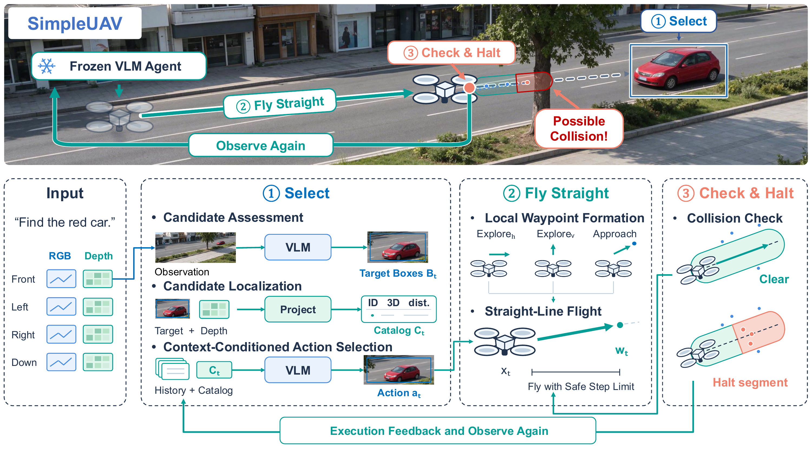

<h1 align="center">SimpleUAV</h1>

<p align="center"><strong>Training-free visual search for aerial object-goal navigation.</strong></p>

<p align="center">
  
  
  
  
</p>

<p align="center">
  <strong>English</strong> · <a href="README.zh-CN.md">简体中文</a><br>
  <a href="#overview">Overview</a> · <a href="#quickstart">Quickstart</a> · <a href="#configuration">Configuration</a> · <a href="#results-and-evaluation">Results</a> · <a href="#troubleshooting">Troubleshooting</a>
</p>

<p align="center"><a href="docs/assets/method.pdf"></a></p>

## Overview

SimpleUAV turns a pretrained vision-language model into a closed-loop aerial search agent. Given a language goal and four RGB-D views, it identifies current target candidates, grounds them in metric geometry, and chooses short navigation actions. Each decision uses the actual outcome of the previous motion, selected history frames, and a compact text memory. The VLM receives RGB images; metric depth is used by geometric grounding and control.

- **Two-stage visual reasoning.** The same VLM first localizes candidates, then selects navigation behavior using current evidence and context. Target actions are bound to candidates from the current observation.
- **Grounded execution.** Depth and camera poses translate image regions into motion goals. The controller checks the local motion corridor during execution and reports where and why movement stopped.
- **Bounded search context.** Four rounds of selected-view history and a model-written text summary retain observations and unfinished search intentions. An ascent guard limits repeated upward exploration at the same horizontal location.
- **Reproducible evaluation.** One entry point checks inputs, freezes code and configuration, runs isolated simulators, and resumes unfinished tasks. SR, OSR, SPL, and NE are retained even when RGB-D recording is disabled.

This branch contains the **UAV-ON implementation**. It runs a pretrained model without task-specific fine-tuning. Evaluation uses **UAV-ON 1.0 adjusted protocol**; the exact settings and differences from the original benchmark are listed [below](#results-and-evaluation).

## Quickstart

This walkthrough uses one GPU, Qwen3.6-35B-A3B-FP8, and four simulator workers. Both the VLM and the simulators run on the configured GPU. Adjust concurrency and model choice to your hardware.

### 1. Check the prerequisites

| Component | Requirement |
|---|---|
| Operating system | Linux, running as a regular user |
| GPU runtime | NVIDIA driver and Vulkan support; enough VRAM for the model, KV cache, and UE instances together |
| Simulator isolation | `bubblewrap` (`bwrap`) installed, with unprivileged user namespaces enabled |
| Python | Separate control and model environments; the examples use Python 3.12 |
| Tools | Git, Conda, and `unzip`; optional tmux for a persistent terminal |
| External assets | Official UAV-ON 1.0 annotations, test scene packages, and a complete local model checkpoint |

The reference setup uses an **RTX PRO 6000 Blackwell 96GB** with four simulator workers. This is a reference configuration, not a minimum VRAM specification. Smaller GPUs may require a smaller supported model and fewer workers. `bwrap` and system GPU dependencies must already be available; Python dependency installation does not install them.

### 2. Clone the repository and install the Python dependencies

```bash
git clone https://github.com/beilu-zhuma/SimpleUAV.git
cd SimpleUAV

# Lightweight navigation / evaluation environment.
conda create -n lvln-agent python=3.12.13 -y
conda run -n lvln-agent python -m pip install -r requirements/uavon-control.txt

# Model-serving environment. Let vLLM resolve its compatible PyTorch dependencies.
conda create -n lvln-model python=3.12.13 -y
conda run -n lvln-model python -m pip install -r requirements/vllm.txt

export LVLN_AGENT_PYTHON="$(conda run -n lvln-agent python -c 'import sys; print(sys.executable)')"
export LVLN_MODEL_PYTHON="$(conda run -n lvln-model python -c 'import sys; print(sys.executable)')"
```

The agent uses the repository's native AirSim RPC client; an additional AirSim Python SDK or depth-prediction service is not required. The dependency files pin the following Python packages:

| Environment | Versions |
|---|---|
| Python | 3.12.13 for both environments |
| Control | NumPy 1.26.4, Pillow 13.0.0, msgpack 1.2.3 |
| Model serving | vLLM 0.31.0, nvidia-ml-py 13.610.43, ninja 1.13.0, huggingface-hub 1.33.0 |
| PyTorch | Resolved by vLLM; the reference package version is 2.13.0 |

Linux GPU drivers, Vulkan, `bwrap`, and any CUDA compilation tools are system prerequisites. Choose wheels and a driver compatible with your hardware; the Python requirements do not install these system components. Follow the [vLLM installation guide](https://docs.vllm.ai/en/latest/getting_started/installation/gpu/) if the standard wheel is unsuitable. Keep the two environments separate, and do not manually replace vLLM's PyTorch dependency with an incompatible build.

Run subsequent commands from the repository root. In a new shell or tmux session, re-export the `LVLN_*` variables or use the same shell environment.

### 3. Prepare the data and model

Choose storage locations you own. Replace these example paths before running:

```bash
export LVLN_DATA_ROOT=/absolute/path/to/uavon
export LVLN_MODEL_DIR=/absolute/path/to/models/Qwen3.6-35B-A3B-FP8
export LVLN_RUN_DIR=/absolute/path/to/results/simpleuav-uavon

# Fixed upstream snapshots for the download commands below.
export LVLN_ANNOTATIONS_REVISION=401767d69eca1643adf6690ad86160f2a09275d7
export LVLN_SCENES_REVISION=7b20a481d36fe6c0746d4e1acbb6ca9663b40a40
export LVLN_MODEL_REVISION=c653bba46dfa06e9658dcc0b0dc87fe4685f14a2
```

| Asset | Official source | Required local content |
|---|---|---|
| Annotations | [UAV-ON dataset](https://huggingface.co/datasets/Kyaren/UAV-ON-dataset) | Complete original `UAV-ON-data/valset/*.json` |
| Simulator | [UAV-ON test environments](https://huggingface.co/datasets/Kyaren/UAV-ON-envs-test) | Extracted test scene directories under `TEST_ENVS/` |
| Default model | [Qwen3.6-35B-A3B-FP8](https://huggingface.co/Qwen/Qwen3.6-35B-A3B-FP8) | Weights, configuration, tokenizer, and processor files |

<details>
<summary><strong>Download commands for a fresh installation</strong></summary>

```bash
conda run -n lvln-model hf download Kyaren/UAV-ON-dataset \
  --revision "$LVLN_ANNOTATIONS_REVISION" \
  --repo-type dataset --include "UAV-ON-data/valset/*" \
  --local-dir "$LVLN_DATA_ROOT/DATASET"

conda run -n lvln-model hf download Kyaren/UAV-ON-envs-test \
  --revision "$LVLN_SCENES_REVISION" \
  --repo-type dataset --include "*.zip" \
  --exclude "CityPark.zip" "BrushifyRoad.zip" "Slum.zip" "DownTown.zip" \
  --local-dir "$LVLN_DATA_ROOT/scene-archives"

mkdir -p "$LVLN_DATA_ROOT/TEST_ENVS"
for archive in "$LVLN_DATA_ROOT"/scene-archives/*.zip; do
  unzip -n "$archive" -d "$LVLN_DATA_ROOT/TEST_ENVS"
done

conda run -n lvln-model hf download Qwen/Qwen3.6-35B-A3B-FP8 \
  --revision "$LVLN_MODEL_REVISION" \
  --local-dir "$LVLN_MODEL_DIR"
```

The launch path uses local model files in offline mode. Finish downloading the complete checkpoint before starting evaluation. The commands pin upstream revisions to avoid silently changing the inputs. Use a fresh model directory for a new download; keep an existing checkpoint intact when reproducing a prepared run. Downloads and extraction can consume substantial disk space; detailed recording is optional.

</details>

Expected layout; representative scene paths are shown:

```text
$LVLN_DATA_ROOT/
├── DATASET/UAV-ON-data/valset/
│   └── *.json                         # all original annotation files
└── TEST_ENVS/
    ├── NYC/NYC1950.sh
    ├── CityStreet/CleanCityStreet.sh
    ├── Barnyard/Barnyard_test1.sh
    ├── Venice/Vinice_test1.sh
    └── ...                           # all ten healthy test scenes
```

Keep the **entire original valset**, including annotations for excluded scenes. The loader validates the 1,000-task source and filters it to 733 tasks. Scene directories must match the official package layout; names such as `Vinice_test1.sh` are intentional. The [official environment note](https://github.com/Kyaren/UAV_ON#notes) identifies CityPark, BrushifyRoad, Slum, and DownTown as problematic; their tasks are excluded automatically.

### 4. Create a local configuration

This writes an ignored, machine-specific config using the paths defined above. **Choose a GPU you are authorized to use and confirm it is idle before `run`.**

```bash
"$LVLN_AGENT_PYTHON" - <<'PY'
import json
import os
from pathlib import Path

config = json.loads(Path("configs/experiments/uavon.example.json").read_text())
data = Path(os.environ["LVLN_DATA_ROOT"])
config["paths"].update(
    python=os.environ["LVLN_AGENT_PYTHON"],
    model_python=os.environ["LVLN_MODEL_PYTHON"],
    annotations=str(data / "DATASET/UAV-ON-data/valset"),
    scenes=str(data / "TEST_ENVS"),
    runtime_root="/tmp",
)
config["models"][0]["path"] = os.environ["LVLN_MODEL_DIR"]
config["gpus"] = [0]           # replace with your available physical GPU index
config["concurrency"] = 4      # lower this if your hardware needs fewer UE workers
Path("configs/experiments/uavon.local.json").write_text(json.dumps(config, indent=2) + "\n")
PY
```

Review the generated JSON, including GPU indices, model path, and ports. Configuration paths are resolved relative to the config file when they are not absolute. See [configuration](#configuration) for the available settings.

### 5. Validate and freeze the experiment

```bash
"$LVLN_AGENT_PYTHON" scripts/experiment.py check \
  --config configs/experiments/uavon.local.json

"$LVLN_AGENT_PYTHON" scripts/experiment.py prepare \
  --config configs/experiments/uavon.local.json \
  --output "$LVLN_RUN_DIR"
```

`check` validates files, source checksums, annotations, and Python dependencies. `prepare` freezes code, effective parameters, and task identities in a **new output directory that must not already exist**. Both commands run on CPU and do not start model or simulator services. GPU availability and real simulator operation are checked during `run`.

To evaluate only part of the task set, add the following to the top-level config **before preparing**:

```json
{"selection": {"count": 10, "seed": 20261116}}
```

This runs ten tasks sampled without replacement from the healthy pool, with the same navigation and scoring settings. Use a separate output directory and a lower `concurrency` if fewer workers are needed. The complete original valset is still required to construct a stable task pool; only scene packages actually selected for this run are checked. If a package is missing, the error lists the required scenes. The download example above supplies all healthy packages for a full evaluation. Remove `selection` and prepare another output directory to evaluate all 733 tasks.

For a copyable ten-task setup, use the commands below instead of the full-set preparation above. They preserve your existing local config and create a separate subset config. The subset config and output directory must not already exist; choose new names if they do.

```bash
"$LVLN_AGENT_PYTHON" - <<'PY'
import json
from pathlib import Path

source = Path("configs/experiments/uavon.local.json")
config = json.loads(source.read_text())
config["selection"] = {"count": 10, "seed": 20261116}
with source.with_name("uavon.subset.local.json").open("x") as handle:
    json.dump(config, handle, indent=2)
    handle.write("\n")
PY

export LVLN_RUN_DIR=/absolute/path/to/results/simpleuav-subset10
"$LVLN_AGENT_PYTHON" scripts/experiment.py prepare \
  --config configs/experiments/uavon.subset.local.json \
  --output "$LVLN_RUN_DIR"
```

Then continue with step 6 below. To restore full-set evaluation, select the original `uavon.local.json` and a new output directory.

### 6. Run the evaluation

```bash
# Pass the required variables explicitly, including when a tmux server already exists.
tmux new-session -s simpleuav -c "$PWD" \
  -e "LVLN_AGENT_PYTHON=$LVLN_AGENT_PYTHON" \
  -e "LVLN_RUN_DIR=$LVLN_RUN_DIR"

"$LVLN_AGENT_PYTHON" scripts/experiment.py run --output "$LVLN_RUN_DIR"
# Detach with Ctrl-B, then D. Reattach with: tmux attach -t simpleuav
```

If tmux is unavailable, execute the `run` command directly in your terminal. The [tmux manual](https://man.openbsd.org/tmux#new-session) documents the session options above.

`run` starts the model service and isolated UE workers automatically. A multi-GPU configuration starts **one TP1 model replica per GPU** and distributes workers across the cards. It releases its own registered model and simulator processes on completion or interruption.

To follow progress from another shell:

```bash
cat "$LVLN_RUN_DIR/portable-status.json"
tail -f "$LVLN_RUN_DIR/attempt-0001/logs/evaluation.log"
```

Each resume creates another `attempt-XXXX/`; use the attempt path recorded in `portable-status.json`. tmux preserves a terminal session, but servers that terminate login sessions may require an administrator-approved persistent user service.

## Configuration

Start from [`uavon.example.json`](configs/experiments/uavon.example.json). The public entry point keeps the main-method settings fixed, with an optional initial scan.

| Field | Default | Purpose |
|---|---|---|
| `gpus` | `[0]` | One to four authorized physical GPU indices |
| `concurrency` | `4` | Total UE workers; 1–16 and divisible by the number of GPUs |
| `models[0].name` | `qwen36` | Supported model alias; must match the checkpoint you supply |
| `models[0].path` | Local path | Complete checkpoint directory |
| `paths.python` / `paths.model_python` | Local paths | Control and vLLM interpreters |
| `paths.annotations` / `paths.scenes` | Local paths | Original valset and extracted `TEST_ENVS` |
| `paths.vulkan_icd` | `""` | Optional path to your NVIDIA Vulkan ICD JSON |
| `paths.runtime_root` | System temporary directory | Short, writable runtime IPC location; `/tmp` is a typical choice |
| `ports.model` / `ports.scene` | `18630` / `30310` | Start of the model and simulator port ranges |
| `record_mode` | `"metrics-only"` | Complete scalar metrics; `"full"` retains detailed observations and logs |
| `method.initial_yaw90` | `false` | Optional 90° scan; counts as one of the 150 decisions |
| `serving.gpu_memory_utilization` | `0.70` | Per-replica vLLM memory fraction; leave headroom for UE |
| `serving.max_num_seqs` | `12` | vLLM scheduler capacity, distinct from simulator concurrency |
| `selection` | Omitted | Optional fixed-seed development subset; omission evaluates all 733 tasks |

Supported aliases are `qwen36`, `qwen3vl8b`, `qwen3vl4b`, `qwen35_9b`, and `qwen35_4b`. Changing models requires supplying the matching complete checkpoint and a compatible vLLM environment. Multi-GPU execution replicates the model; each selected GPU must fit its replica and assigned simulators.

The initial scan is **off by default**. With `initial_yaw90=true`, the scan uses one decision and leaves up to 149 navigation decisions; the first navigation query receives labeled pre-scan images. With it off, all 150 decisions are available for navigation.

Change configuration before `prepare`. A prepared experiment resumes with its frozen settings; use a new output directory for a different configuration.

## Results and evaluation

Successful completion produces `summary.json` at the run root. `portable-status.json` records the phase, result location, and resource-release status. Within the latest attempt:

```text
$LVLN_RUN_DIR/
├── method.json, machine-config.json  # frozen effective settings
├── data/manifest.json               # task identities and data provenance
├── source_snapshot/, launcher/      # frozen code and entry point
├── portable-status.json             # current phase and attempt
├── summary.json                     # final aggregate after a complete run
└── attempt-0001/
    ├── logs/model-0.log
    ├── logs/evaluation.log
    └── full/
        ├── results.json             # per-task results / checkpoint
        ├── summary.json             # aggregate and official-math verification
        └── uavon_metrics/           # offline scoring inputs and outputs
```

```bash
"$LVLN_AGENT_PYTHON" - <<'PY'
import json
import os
from pathlib import Path

summary = json.loads((Path(os.environ["LVLN_RUN_DIR"]) / "summary.json").read_text())
print(f"Completed: {summary['total_finished']} | Successes: {summary['success']}")
for name in ("sr", "osr", "spl"):
    print(f"{name.upper()}: {summary[name]:.2%}")
print(f"NE: {summary['ne_m']:.2f} m")
PY
```

SR, OSR, and SPL are stored as fractions; NE is in meters. An incomplete run retains task checkpoints and failure information; it is not reported as a complete evaluation with missing tasks silently counted as zero.

### Protocol at a glance

| Setting | Released configuration |
|---|---|
| Task set | UAV-ON 1.0 valset: 1,000 original tasks → 733 tasks across ten healthy test scenes |
| Observations | Front / left / right / down RGB-D |
| Decision budget | 150 high-level decisions; each motion can contain multiple controller updates |
| Context | Four rounds of selected-view history + text memory up to 1,200 characters |
| Motion | Physical velocity commands; at most 6m per segment, 2m target standoff |
| Spawn | Original start position shifted upward by 2m |
| STOP / success | 10m depth-estimated STOP gate / 20m offline target-distance threshold |
| Collision | Dedicated `simGetCollisionInfo`; collision terminates the episode, with spawn collisions labeled separately |
| Inference | Temperature 0, thinking off, strict JSON; MTP off, prefix caching on |

SR requires an accepted STOP within the offline success radius. Main OSR uses decision endpoints and the implementation's terminal boundary rules. SPL uses the original dataset geodesic reference and the actual sampled path; NE is the final target distance. Collision failures contribute zero SR/OSR/SPL. Depth checks operate locally during motion; upward exploration has an explicit depth-coverage exception and a repeated-ascent guard, so they do not constitute a general collision-free guarantee.

Report results as **UAV-ON 1.0 adjusted protocol**. The filtered task set, spawn offset, physical controller, and high-level decision budget differ from the original benchmark execution. In particular, **150 decisions do not mean 150 low-level movement steps**. The full protocol is documented in [`docs/benchmarks.md`](docs/benchmarks.md) (Chinese).

## Stop and resume

```bash
"$LVLN_AGENT_PYTHON" scripts/experiment.py stop --output "$LVLN_RUN_DIR"
# Wait for the controller to exit and release its registered resources.
"$LVLN_AGENT_PYTHON" scripts/experiment.py resume --output "$LVLN_RUN_DIR"
```

`stop` requests a graceful shutdown. `resume` checks the frozen contract, retains settled task results, and retries unfinished tasks in a new attempt without overwriting prior attempts. Resolve the recorded error and wait for old run processes to exit before resuming. Keep the prepared directory and its external data/model paths in place.

## Modifying source code

After editing Python files in `src/`, explicitly refresh the source manifest from the repository root:

```bash
"$LVLN_AGENT_PYTHON" scripts/experiment.py refresh-source
"$LVLN_AGENT_PYTHON" scripts/experiment.py check \
  --config configs/experiments/uavon.local.json
"$LVLN_AGENT_PYTHON" scripts/experiment.py prepare \
  --config configs/experiments/uavon.local.json \
  --output /absolute/path/to/results/simpleuav-modified
```

`refresh-source` registers changed, added, and removed Python files in `src/MANIFEST.json`; it runs on CPU without a model or simulator. Review your changes and run the relevant tests before evaluation. Updating only the JSON configuration does not require this command. A new output directory must not already exist.

Prepared runs retain their own frozen source and checksums. The refresh command rejects prepared output directories and their descendants; it cannot repair or overwrite an altered frozen run. Resume a run using its original snapshot, or prepare a new run from the edited repository. The internal Python namespace remains `lightning_vln` for import compatibility; the public entry point is `scripts/experiment.py`.

## Troubleshooting

| Symptom | What to check |
|---|---|
| `bwrap` missing, namespace denied, or root-user rejection | Use a regular Linux user with working unprivileged bubblewrap isolation; ask your administrator to provision the system dependency. |
| Unknown / incomplete valset or scene not found | Supply the complete original 1.0 valset and scene packages needed by the selected tasks. Check directory nesting and official script names. |
| First run refuses a GPU or port | Select an idle, authorized physical GPU and non-overlapping free ports; the launcher will not take over existing tasks. |
| vLLM exits or runs out of memory | Read `logs/model-<gpu>.log`. Check the complete checkpoint, driver/vLLM compatibility, and shared model/UE memory budget; prepare a fresh configuration with appropriate resources. |
| CUDA build / `ninja` error | Check the model environment's `ninja` and compatible CUDA toolchain; its interpreter directory is added to `PATH` automatically. |
| Unix IPC path too long | Set `paths.runtime_root` to a short writable directory, such as `/tmp`, before preparing. |
| UE / Vulkan startup failure | Check scene executable permissions, NVIDIA Vulkan support, optional `paths.vulkan_icd`, and the attempt's worker logs. |
| Connection closed after SSH logout | Check the server's login-session policy. Use an allowed persistent user service if tmux alone is insufficient. |
| Source/config checksum changed on resume | Use the original frozen experiment. Prepare a new directory for modified settings rather than editing the frozen snapshot. |
| Method source version changed before `check` / `prepare` | After reviewing source edits, run `refresh-source` in the repository and prepare a new output directory. |

## Code map

```text
scripts/experiment.py                     # evaluation CLI and explicit source-manifest refresh
scripts/portable_experiments/             # configuration, snapshots, resource lifecycle
src/lightning_vln/core/
    vlm.py, prompts.py, context.py        # model requests, prompts, history and memory
    evidence.py, geometry.py              # current target grounding and geometric checks
    agent.py, simulator.py                # short-segment execution and AirSim boundary
src/lightning_vln/adapters/uavon/         # UAV-ON tasks, search guards, collision/scoring protocol
configs/experiments/uavon.example.json    # starting configuration
requirements/                            # pinned control and model-serving dependencies
tests/                                   # CPU regression and deterministic replay
third_party/UAV-ON/                      # upstream benchmark/scoring reference
```

CPU checks can run without loading a model or starting UE:

```bash
CUDA_VISIBLE_DEVICES='' PYTHONDONTWRITEBYTECODE=1 PYTHONPATH=src:scripts:tests \
  "$LVLN_AGENT_PYTHON" -B -m unittest discover -s tests -q
```

## Automated checks and release version

[CPU tests](.github/workflows/cpu-tests.yml) run on GitHub-hosted runners for pushes and pull requests to `main`, and can also be started from the Actions tab. They install only the control dependencies and do not start a model or simulator.

The fixed release is tagged `v0.1.0`. To use it from a clean checkout:

```bash
git checkout v0.1.0
```

## Acknowledgments and licensing

We thank [UAV-ON](https://github.com/Kyaren/UAV_ON), [Qwen](https://huggingface.co/Qwen), and [vLLM](https://github.com/vllm-project/vllm) for their benchmark, models, and inference infrastructure. Upstream scoring references and attribution are retained in `third_party/UAV-ON/`.

Original SimpleUAV code is licensed under the [MIT License](LICENSE). Third-party sources and attribution are listed in [third-party notices](docs/third-party.md). Model weights, datasets, and scene packages are distributed separately under their respective terms.
