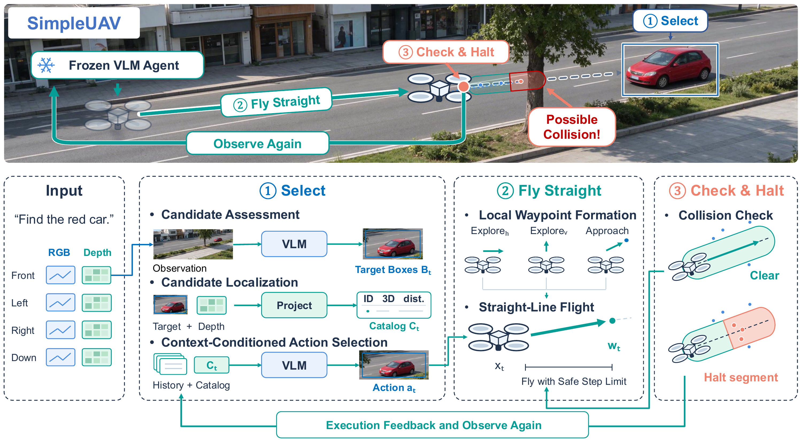

<h1 align="center">SimpleUAV</h1>

<p align="center"><strong>无需任务专用训练的无人机视觉目标搜索与导航。</strong></p>

<p align="center">
  
  
  
  
</p>

<p align="center">
  <a href="README.md">English</a> · <strong>简体中文</strong><br>
  <a href="#方法概览">方法概览</a> · <a href="#快速开始">快速开始</a> · <a href="#配置说明">配置说明</a> · <a href="#结果与评测协议">实验结果</a> · <a href="#常见问题">常见问题</a>
</p>

<p align="center"><a href="docs/assets/method.pdf"></a></p>

## 方法概览

SimpleUAV 利用预训练视觉语言模型实现闭环无人机搜索。输入语言目标与四路 RGB-D 观测，系统先识别当前目标候选，再结合米制深度定位，选择短段导航动作。后续决策结合上一次运动的真实结果、有限历史关键帧与简短文字记忆。RGB 图像进入 VLM，米制深度由几何定位和控制层使用。

- **两阶段视觉推理。** 同一个 VLM 先定位候选，再结合当前证据与上下文选择导航行为。接近与停止动作绑定当前观测中的候选。
- **几何约束的执行。** 深度与相机位姿将图像区域转换为运动目标。控制器在执行中检查局部通道，反馈实际停在哪里、为什么停下。
- **有界搜索上下文。** 最近四轮的所选视图与模型维护的文字摘要保留观察和未完成意图；上升保护限制同一水平位置的重复上升探索。
- **可复现评测。** 统一入口检查输入、冻结源码与配置、启动隔离仿真，并接续未完成任务。关闭 RGB-D 留档仍保留 SR、OSR、SPL、NE。

本分支提供 **UAV-ON 实现**，无需对预训练模型进行任务专用微调。评测采用 **UAV-ON 1.0 adjusted protocol**，具体参数及相对官方实现的差异见[评测协议](#结果与评测协议)。

## 快速开始

以下示例使用单张 GPU、Qwen3.6-35B-A3B-FP8 与四路仿真。模型和仿真共同使用配置指定的 GPU，请按硬件容量调整模型与并发。

### 1. 确认运行条件

| 组件 | 要求 |
|---|---|
| 操作系统 | Linux，使用普通用户运行 |
| GPU 运行时 | NVIDIA 驱动与 Vulkan；显存需同时容纳模型、KV 缓存和 UE 实例 |
| 仿真隔离 | 已安装 `bubblewrap`（`bwrap`），允许非特权用户命名空间 |
| Python | 控制环境与模型环境分开；以下命令使用 Python 3.12 |
| 命令行工具 | Git、Conda、`unzip`；tmux 可选，用于保留终端会话 |
| 外置资源 | 官方 UAV-ON 1.0 任务标注、测试场景包、完整本地模型 |

参考配置为 **RTX PRO 6000 Blackwell 96GB、单卡四路仿真**，这不代表最低显存要求。较小显卡可能需要更小的受支持模型与更少的仿真实例。`bwrap` 及 GPU 系统依赖应已由机器管理方准备，安装 Python 依赖不会安装这些系统组件。

### 2. 获取代码并安装 Python 依赖

```bash
git clone https://github.com/beilu-zhuma/SimpleUAV.git
cd SimpleUAV

# 轻量导航与评测环境。
conda create -n lvln-agent python=3.12.13 -y
conda run -n lvln-agent python -m pip install -r requirements/uavon-control.txt

# 模型服务环境，由vLLM解析匹配的PyTorch依赖。
conda create -n lvln-model python=3.12.13 -y
conda run -n lvln-model python -m pip install -r requirements/vllm.txt

export LVLN_AGENT_PYTHON="$(conda run -n lvln-agent python -c 'import sys; print(sys.executable)')"
export LVLN_MODEL_PYTHON="$(conda run -n lvln-model python -c 'import sys; print(sys.executable)')"
```

项目直接使用自带的 AirSim RPC 客户端，无需另装 AirSim Python SDK 或深度预测服务。依赖文件固定以下 Python 包版本：

| 环境 | 版本 |
|---|---|
| Python | 两个环境均使用 3.12.13 |
| 控制环境 | NumPy 1.26.4、Pillow 13.0.0、msgpack 1.2.3 |
| 模型服务 | vLLM 0.31.0、nvidia-ml-py 13.610.43、ninja 1.13.0、huggingface-hub 1.33.0 |
| PyTorch | 由 vLLM 解析安装，参考包版本为 2.13.0 |

Linux 显卡驱动、Vulkan、`bwrap` 和需要时使用的 CUDA 编译工具属于系统依赖。请按硬件选择兼容的驱动与 wheel；Python requirements 不会安装这些系统组件。标准 wheel 不适用时参考 [vLLM 安装文档](https://docs.vllm.ai/en/latest/getting_started/installation/gpu/)。两个 Python 环境保持独立，不要手动把 vLLM 的 PyTorch 依赖替换为不兼容版本。

后续命令均在仓库根目录执行。若切换到新 shell 或 tmux 会话，需重新设置 `LVLN_*` 变量或继承原 shell 环境。

### 3. 准备数据与模型

使用有写入权限的自有存储位置。执行前替换以下示例路径：

```bash
export LVLN_DATA_ROOT=/absolute/path/to/uavon
export LVLN_MODEL_DIR=/absolute/path/to/models/Qwen3.6-35B-A3B-FP8
export LVLN_RUN_DIR=/absolute/path/to/results/simpleuav-uavon

# 下方下载命令使用的固定上游版本。
export LVLN_ANNOTATIONS_REVISION=401767d69eca1643adf6690ad86160f2a09275d7
export LVLN_SCENES_REVISION=7b20a481d36fe6c0746d4e1acbb6ca9663b40a40
export LVLN_MODEL_REVISION=c653bba46dfa06e9658dcc0b0dc87fe4685f14a2
```

| 资源 | 官方来源 | 本地内容 |
|---|---|---|
| 任务标注 | [UAV-ON dataset](https://huggingface.co/datasets/Kyaren/UAV-ON-dataset) | 完整原始 `UAV-ON-data/valset/*.json` |
| 仿真场景 | [UAV-ON test environments](https://huggingface.co/datasets/Kyaren/UAV-ON-envs-test) | 解压到 `TEST_ENVS/` 的测试场景目录 |
| 默认模型 | [Qwen3.6-35B-A3B-FP8](https://huggingface.co/Qwen/Qwen3.6-35B-A3B-FP8) | 权重、配置、tokenizer 与 processor 文件 |

<details>
<summary><strong>首次安装的数据与模型下载命令</strong></summary>

```bash
conda run -n lvln-model hf download Kyaren/UAV-ON-dataset \
  --revision "$LVLN_ANNOTATIONS_REVISION" \
  --repo-type dataset --include "UAV-ON-data/valset/*" \
  --local-dir "$LVLN_DATA_ROOT/DATASET"

conda run -n lvln-model hf download Kyaren/UAV-ON-envs-test \
  --revision "$LVLN_SCENES_REVISION" \
  --repo-type dataset --include "*.zip" \
  --exclude "CityPark.zip" "BrushifyRoad.zip" "Slum.zip" "DownTown.zip" \
  --local-dir "$LVLN_DATA_ROOT/scene-archives"

mkdir -p "$LVLN_DATA_ROOT/TEST_ENVS"
for archive in "$LVLN_DATA_ROOT"/scene-archives/*.zip; do
  unzip -n "$archive" -d "$LVLN_DATA_ROOT/TEST_ENVS"
done

conda run -n lvln-model hf download Qwen/Qwen3.6-35B-A3B-FP8 \
  --revision "$LVLN_MODEL_REVISION" \
  --local-dir "$LVLN_MODEL_DIR"
```

启动入口使用离线模式读取本地模型，开始评测前应完成整个 checkpoint 的下载。命令固定上游 revision，避免资源内容随更新而悄悄变化。新下载使用新的模型目录；复现已准备的运行时，保留原有 checkpoint，不覆盖其文件。下载与解压需要较大磁盘空间，详细记录可按需开启。

</details>

解压后的目录应类似如下结构，其中只展示部分场景：

```text
$LVLN_DATA_ROOT/
├── DATASET/UAV-ON-data/valset/
│   └── *.json                         # 全部原始任务标注
└── TEST_ENVS/
    ├── NYC/NYC1950.sh
    ├── CityStreet/CleanCityStreet.sh
    ├── Barnyard/Barnyard_test1.sh
    ├── Venice/Vinice_test1.sh
    └── ...                           # 全部十个健康测试场景
```

保留**完整原始 valset**，包括被排除场景的标注。加载器会校验原始 1,000 条任务，再过滤为 733 条。场景目录应与官方包一致，`Vinice_test1.sh` 等文件名是官方实际拼写。[官方环境说明](https://github.com/Kyaren/UAV_ON#notes)指出 CityPark、BrushifyRoad、Slum、DownTown 存在问题，本项目会自动排除对应任务。

### 4. 创建本机配置

下面利用前述路径生成不会提交到 Git 的本机 JSON 配置。**请在 `run` 前确认指定物理 GPU 已获授权且空闲。**

```bash
"$LVLN_AGENT_PYTHON" - <<'PY'
import json
import os
from pathlib import Path

config = json.loads(Path("configs/experiments/uavon.example.json").read_text())
data = Path(os.environ["LVLN_DATA_ROOT"])
config["paths"].update(
    python=os.environ["LVLN_AGENT_PYTHON"],
    model_python=os.environ["LVLN_MODEL_PYTHON"],
    annotations=str(data / "DATASET/UAV-ON-data/valset"),
    scenes=str(data / "TEST_ENVS"),
    runtime_root="/tmp",
)
config["models"][0]["path"] = os.environ["LVLN_MODEL_DIR"]
config["gpus"] = [0]           # 替换为当前可用且已授权的物理GPU编号
config["concurrency"] = 4      # 按硬件容量减少UE并发
Path("configs/experiments/uavon.local.json").write_text(json.dumps(config, indent=2) + "\n")
PY
```

检查生成的 JSON，尤其是 GPU 编号、模型路径与端口。配置中的相对路径以配置文件目录为基准。可用选项见[配置说明](#配置说明)。

### 5. 检查输入并冻结实验

```bash
"$LVLN_AGENT_PYTHON" scripts/experiment.py check \
  --config configs/experiments/uavon.local.json

"$LVLN_AGENT_PYTHON" scripts/experiment.py prepare \
  --config configs/experiments/uavon.local.json \
  --output "$LVLN_RUN_DIR"
```

`check` 校验文件、源码摘要、任务标注与 Python 依赖。`prepare` 将源码、实际参数和任务身份冻结到**事先不存在的新输出目录**。两者仅使用 CPU，不启动模型或仿真；GPU 空闲与仿真实际运行能力在 `run` 阶段检查。

只测部分任务时，在 `prepare` 前向配置顶层增加：

```json
{"selection": {"count": 10, "seed": 20261116}}
```

这样会从健康任务池无放回抽取十条，使用相同导航方法与评分设置。请使用独立输出目录，并按需要降低 `concurrency`。完整原始 valset 仍用于构建稳定的任务池；场景包只检查本次实际抽中的场景，缺包时错误会列出所需场景。上方下载示例为完整评测准备所有健康场景包。正式 733 条评测请删除 `selection`，重新准备另一个输出目录。

### 6. 启动评测

```bash
# 显式传入所需变量，兼容已有tmux server的情况。
tmux new-session -s simpleuav -c "$PWD" \
  -e "LVLN_AGENT_PYTHON=$LVLN_AGENT_PYTHON" \
  -e "LVLN_RUN_DIR=$LVLN_RUN_DIR"

"$LVLN_AGENT_PYTHON" scripts/experiment.py run --output "$LVLN_RUN_DIR"
# Ctrl-B、D脱离；重新连接：tmux attach -t simpleuav
```

若没有 tmux，可直接在终端执行上述 `run` 命令。会话参数见 [tmux 手册](https://man.openbsd.org/tmux#new-session)。

`run` 自动启动模型服务和隔离的 UE 实例。多卡时采用**每卡一个 TP1 模型副本**，并将仿真分配到各卡。完成或中断时，入口负责释放其登记的本轮模型与仿真进程。

可以从另一个 shell 查看进度：

```bash
cat "$LVLN_RUN_DIR/portable-status.json"
tail -f "$LVLN_RUN_DIR/attempt-0001/logs/evaluation.log"
```

接续会创建新的 `attempt-XXXX/`，当前目录以 `portable-status.json` 为准。tmux 保留终端会话；若服务器会在 SSH 退出时清理整个登录会话，需要使用管理方允许的持久用户服务。

## 配置说明

以 [`uavon.example.json`](configs/experiments/uavon.example.json) 为起点。公开入口固定主方法参数，额外提供初始扫描开关。

| 字段 | 默认值 | 用途 |
|---|---|---|
| `gpus` | `[0]` | 1–4 张已授权的物理 GPU 编号 |
| `concurrency` | `4` | UE 总并发，1–16 且必须能被 GPU 数量整除 |
| `models[0].name` | `qwen36` | 受支持模型别名，需与实际权重匹配 |
| `models[0].path` | 本地路径 | 完整 checkpoint 目录 |
| `paths.python` / `paths.model_python` | 本地路径 | 控制与 vLLM 解释器 |
| `paths.annotations` / `paths.scenes` | 本地路径 | 原始 valset 与解压后的 `TEST_ENVS` |
| `paths.vulkan_icd` | `""` | 可选的 NVIDIA Vulkan ICD JSON 路径 |
| `paths.runtime_root` | 系统临时目录 | 短且可写的运行时 IPC 目录，通常可用 `/tmp` |
| `ports.model` / `ports.scene` | `18630` / `30310` | 模型与仿真端口范围的起点 |
| `record_mode` | `"metrics-only"` | 保留完整标量指标；`"full"` 额外保留详细观测与日志 |
| `method.initial_yaw90` | `false` | 可选初始 90° 扫描，占用 150 次预算中的一次 |
| `serving.gpu_memory_utilization` | `0.70` | 每个 vLLM 副本的显存比例，应为 UE 预留空间 |
| `serving.max_num_seqs` | `12` | vLLM 调度容量，与仿真并发数不同 |
| `selection` | 不填写 | 可选固定种子开发子集；省略即评测全部 733 条 |

支持的模型别名为 `qwen36`、`qwen3vl8b`、`qwen3vl4b`、`qwen35_9b`、`qwen35_4b`。更换模型时需同时指定对应完整 checkpoint，并使用兼容的 vLLM 环境。多卡使用模型副本，每张卡均需容纳一个完整副本及分配给它的仿真。

初始扫描**默认关闭**。设置 `initial_yaw90=true` 后，扫描占用一次决策，最多剩余 149 次导航，首次导航加入明确标记的扫描前图像；关闭时 150 次均可用于导航。

配置应在 `prepare` 前调整。已准备的实验按冻结参数恢复，更换配置需新建输出目录。

## 结果与评测协议

完整结束后，根目录生成 `summary.json`。`portable-status.json` 记录阶段、结果位置及资源释放状态。最新 attempt 内包含：

```text
$LVLN_RUN_DIR/
├── method.json, machine-config.json  # 冻结的实际配置
├── data/manifest.json               # 任务身份与数据来源
├── source_snapshot/, launcher/      # 冻结源码与入口
├── portable-status.json             # 当前阶段与attempt
├── summary.json                     # 完整结束后的聚合结果
└── attempt-0001/
    ├── logs/model-0.log
    ├── logs/evaluation.log
    └── full/
        ├── results.json             # 逐任务结果与检查点
        ├── summary.json             # 聚合指标及官方数学核验
        └── uavon_metrics/           # 离线评分输入与输出
```

```bash
"$LVLN_AGENT_PYTHON" - <<'PY'
import json
import os
from pathlib import Path

summary = json.loads((Path(os.environ["LVLN_RUN_DIR"]) / "summary.json").read_text())
print(f"Completed: {summary['total_finished']} | Successes: {summary['success']}")
for name in ("sr", "osr", "spl"):
    print(f"{name.upper()}: {summary[name]:.2%}")
print(f"NE: {summary['ne_m']:.2f} m")
PY
```

SR、OSR、SPL 存储为 0–1 的比例，NE 单位为米。任务未完整结束时保留检查点与错误信息，不会将缺测悄悄补零后发布完整结果。

### 主要评测设置

| 设置 | 本分支实现 |
|---|---|
| 任务集 | UAV-ON 1.0 valset：1,000 条原始任务 → 十个健康测试场景的 733 条 |
| 观测 | 前 / 左 / 右 / 下四路 RGB-D |
| 决策预算 | 150 次高层决策，每次运动可包含多个底层控制更新 |
| 上下文 | 最近四轮所选视图历史＋最多 1,200 字符文字记忆 |
| 运动 | 物理速度控制，每段最多 6m，接近目标保留 2m 停距 |
| 出生点 | 原始起点向上平移 2m |
| STOP / 成功 | 深度估距 STOP 门限 10m / 离线真实目标距离门限 20m |
| 碰撞 | 专用 `simGetCollisionInfo`；碰撞立即结束，出生碰撞单独标记 |
| 推理 | Temperature 0、thinking 关闭、严格 JSON；MTP 关闭、Prefix Cache 开启 |

SR 要求接受 STOP 且进入离线成功半径；主 OSR 使用决策终点与本实现的终止边界。SPL 使用数据集原始 geodesic distance 和实际采样路径，NE 为最终目标距离。碰撞任务的 SR/OSR/SPL 为零。深度检查作用于运动中的局部通道；纯上升探索有明确的深度覆盖豁免及重复上升保护，不代表一般性的无碰撞保证。

对外汇报时请注明 **UAV-ON 1.0 adjusted protocol**。任务过滤、出生高度、物理控制与高层决策预算均有别于原始 benchmark 执行方式，尤其是 **150 次决策不等于 150 个底层运动小步**。详细口径见 [`docs/benchmarks.md`](docs/benchmarks.md)。

## 停止与接续

```bash
"$LVLN_AGENT_PYTHON" scripts/experiment.py stop --output "$LVLN_RUN_DIR"
# 等待控制器退出并释放已登记的本轮资源。
"$LVLN_AGENT_PYTHON" scripts/experiment.py resume --output "$LVLN_RUN_DIR"
```

`stop` 请求正常停止；`resume` 校验冻结契约，保留已结算任务，并在新 attempt 中接续未完成任务，不覆盖历史 attempt。请先处理已记录的错误、等待旧进程退出，再接续。保留原准备目录及其外置数据、模型路径。

## 修改源码后运行

编辑 `src/` 下的 Python 文件后，在仓库根目录显式更新源码清单：

```bash
"$LVLN_AGENT_PYTHON" scripts/experiment.py refresh-source
"$LVLN_AGENT_PYTHON" scripts/experiment.py check \
  --config configs/experiments/uavon.local.json
"$LVLN_AGENT_PYTHON" scripts/experiment.py prepare \
  --config configs/experiments/uavon.local.json \
  --output /absolute/path/to/results/simpleuav-modified
```

`refresh-source` 把修改、新增和删除的 Python 文件登记到 `src/MANIFEST.json`，只使用 CPU，不启动模型或仿真。评测前先审阅源码改动并执行相关测试。只修改 JSON 配置不需要运行此命令。新的输出目录必须尚不存在。

已准备的运行保留各自冻结源码与 SHA。刷新命令会拒绝已准备的输出目录及其子目录，不能用来修复或覆盖被改动的冻结运行。接续应使用原冻结快照；修改方法后则从源码仓库准备新运行。内部 Python 模块名仍为 `lightning_vln`，保持导入兼容，公开入口为 `scripts/experiment.py`。

## 常见问题

| 现象 | 排查方向 |
|---|---|
| 缺少 `bwrap`、命名空间被禁用或拒绝 root | 使用允许非特权 bubblewrap 隔离的普通 Linux 用户；请管理方配置系统依赖。 |
| valset 不完整或找不到场景 | 使用完整原始 1.0 valset，以及所选任务需要的场景包，检查目录嵌套及官方脚本名。 |
| 首次启动拒绝 GPU 或端口 | 选择已授权的空闲物理 GPU 和不重叠的空闲端口，入口不会接管其他任务。 |
| vLLM 退出或显存不足 | 查看 `logs/model-<gpu>.log`；检查权重完整性、驱动/vLLM兼容性及模型和 UE 的共同显存需求，按资源调整后新建配置与输出。 |
| CUDA 编译或 `ninja` 报错 | 检查模型环境的 `ninja` 及所需 CUDA 工具链；模型解释器目录会自动加入 `PATH`。 |
| Unix IPC 路径过长 | 在准备前把 `paths.runtime_root` 设为短且可写的目录，例如 `/tmp`。 |
| UE / Vulkan 启动失败 | 检查场景可执行权限、NVIDIA Vulkan、可选 `paths.vulkan_icd` 与对应 worker 日志。 |
| SSH 断开后任务退出 | 检查服务器登录会话策略；tmux 不足时使用管理方允许的持久用户服务。 |
| 接续时源码或配置 SHA 改变 | 使用原冻结实验；变更设置时准备新目录，不编辑冻结快照。 |
| `check` / `prepare` 前提示方法源码版本改变 | 审阅源码改动后在仓库执行 `refresh-source`，再准备新输出目录。 |

## 代码结构

```text
scripts/experiment.py                     # 评测入口与显式源码清单更新
scripts/portable_experiments/             # 配置、源码冻结与资源生命周期
src/lightning_vln/core/
    vlm.py, prompts.py, context.py        # 模型请求、提示词、历史与记忆
    evidence.py, geometry.py              # 当前目标定位与几何检查
    agent.py, simulator.py                # 短段运动执行与AirSim边界
src/lightning_vln/adapters/uavon/         # 任务、搜索保护、碰撞与评分协议
configs/experiments/uavon.example.json    # 起始配置
requirements/                            # 固定版本的控制与模型服务依赖
tests/                                   # CPU回归与确定性回放
third_party/UAV-ON/                      # 上游benchmark与评分参考
```

不加载模型、不启动 UE 也可执行 CPU 验证：

```bash
CUDA_VISIBLE_DEVICES='' PYTHONDONTWRITEBYTECODE=1 PYTHONPATH=src:scripts:tests \
  "$LVLN_AGENT_PYTHON" -B -m unittest discover -s tests -q
```

## 自动检查与发布版本

向 `main` 推送或提交 Pull Request 时，[CPU 测试](.github/workflows/cpu-tests.yml)会在 GitHub 提供的运行器上自动执行，也可从 Actions 页面手动启动。只安装控制环境依赖，不启动模型或仿真。

固定发布版本标记为 `v0.1.0`。需要使用此版本时，在没有未提交修改的检出目录执行：

```bash
git checkout v0.1.0
```

## 致谢与许可

感谢 [UAV-ON](https://github.com/Kyaren/UAV_ON)、[Qwen](https://huggingface.co/Qwen) 与 [vLLM](https://github.com/vllm-project/vllm) 提供 benchmark、模型与推理基础设施。上游评分参考与署名保留在 `third_party/UAV-ON/`。

SimpleUAV 原创代码采用 [MIT 许可证](LICENSE)。第三方代码的来源和署名见[第三方说明](docs/third-party.md)。模型权重、数据集与场景包独立分发，遵循各自使用条款。
